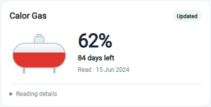
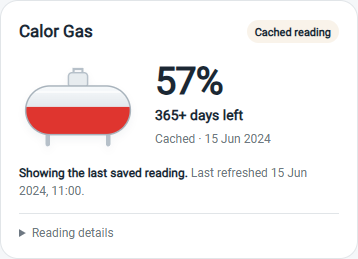
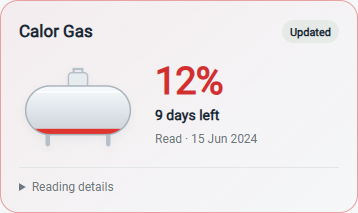
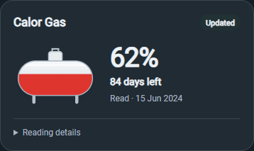
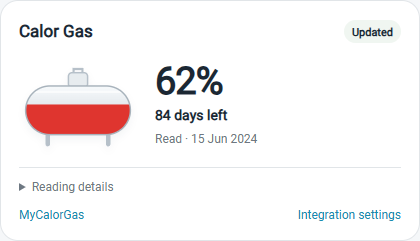
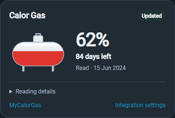

# Calor Gas for Home Assistant

[](https://github.com/mbsintegrations/HomeAssistant-CalorGas/actions/workflows/validate.yml)
[](https://www.hacs.xyz/docs/faq/custom_repositories/)
[](https://github.com/mbsintegrations/HomeAssistant-CalorGas/releases)
[](LICENSE)

[](https://my.home-assistant.io/redirect/hacs_repository/?owner=mbsintegrations&repository=HomeAssistant-CalorGas&category=integration)
[](https://my.home-assistant.io/redirect/config_flow_start/?domain=calor_gas)

[](https://paypal.me/mwahl1973)

See your MyCalorGas tank level, estimated days remaining and delivery status in Home Assistant. A bundled tank card provides desktop, phone and compact layouts, with a visual editor and clear indicators when the portal is unavailable.

This is an **unofficial community integration**, with original artwork. It is not affiliated with or endorsed by Calor. It is a custom integration installed through HACS or manually; it does not require a Supervisor add-on.

**First public beta:** `1.1.0b1`. Available as a HACS custom repository.

## Features

- Native Home Assistant setup dialog with email and masked password fields; no credentials in dashboard YAML.
- Six sensors from one shared portal refresh: tank level, estimated days, source reading date, run-out date, delivery status and last successful sync.
- Automatic polling every **six hours**, with session reuse and bounded login/redirect attempts.
- Last successful readings survive website failures and Home Assistant restarts. Cached data stays visibly marked with its original sync time.
- Correct handling of `365+` estimates, missing forecasts and a real zero tank level.
- Bundled tank card, visual configuration, more-info interaction, low-level indication and light/dark support.
- Local logo assets, English setup text, reauthentication, credential reconfiguration and privacy-filtered diagnostics.

## Preview

The following are **synthetic examples**, not household data. The card adapts to Home Assistant themes and available width.

| Desktop | Phone during a portal outage |
| --- | --- |
|  |  |

| Low level | Dark theme | Compact |
| --- | --- | --- |
|  |  |  |

## Requirements and supported portal

- Home Assistant **2026.10.0 or newer**.
- A working account at [www.mycalorgas.com](https://www.mycalorgas.com/) whose **Tank Delivery** page provides tank telemetry.
- Internet access from Home Assistant to that HTTPS origin.
- [HACS](https://www.hacs.xyz/docs/use/) for the recommended installation method, or file access for manual installation.

Development is based on the MyCalorGas portal used in Ireland. Other Calor websites, login systems and countries are not verified. The integration discovers the currently selected tank account; choosing between multiple tank accounts within one login is not supported. Each entry must resolve one unambiguous account. This reads website data rather than a documented public Calor API, so portal changes can require an integration update.

## Install with HACS

1. Install and configure [HACS](https://www.hacs.xyz/docs/use/) if needed.
2. In **HACS**, open the top-right menu and choose **Custom repositories**.
3. Add `https://github.com/mbsintegrations/HomeAssistant-CalorGas` with type **Integration**.
4. Find **Calor Gas**, open it and select **Download**. For the first beta, select `1.1.0b1` if offered, enable beta versions if needed, or select the default branch.
5. **Restart Home Assistant**.
6. Continue with [Connect your account](#connect-your-account).

Adding a custom repository makes it available in your own HACS installation.

## Manual installation

1. Download **`calor_gas.zip`** from a [release](https://github.com/mbsintegrations/HomeAssistant-CalorGas/releases).
2. Extract it into the `custom_components` folder inside your Home Assistant configuration directory. Create that folder if needed.
3. Confirm this structure; avoid a second nested `calor_gas` directory:

   ```text
   <config>/
   ├── configuration.yaml
   └── custom_components/
       └── calor_gas/
           ├── __init__.py
           ├── manifest.json
           ├── config_flow.py
           ├── brand/
           └── frontend/
   ```

4. **Restart Home Assistant** and connect your account below.

Alternatively, download the repository source and copy **only** `custom_components/calor_gas` to that location. Keep the complete directory, including `brand` and `frontend`. The release includes `SHA256SUMS` for verifying the manual ZIP.

## Connect your account

1. Go to **Settings → Devices & services → Add integration**.
2. Search for **Calor Gas**.
3. In the popup, enter your **MyCalorGas email address and password**.
4. Submit. Home Assistant validates the login, discovers the tank and creates the sensors.

Credentials are stored by your own Home Assistant installation and sent only to `https://www.mycalorgas.com`. They are not sent to GitHub or placed in the card configuration. Protect your Home Assistant backups as they may contain integration credentials.

To change the login, use the integration entry's **Reconfigure** menu. Reauthentication is also supported when Calor rejects an existing login. Both retain the same account's entity identities and cached readings; a login resolving a different account is rejected. Duplicate entries for the same account are prevented.

A first installation needs one successful reading. If Calor is unavailable before that, setup cannot manufacture an initial value. Existing configured entries with a validated saved reading can start from their cache during an outage.

## Add the tank card

For normal storage-managed dashboard resources, the integration registers its bundled JavaScript module automatically.

1. Open your dashboard and select **Edit dashboard → Add card**.
2. Select **Calor Gas tank** for a clean layout, or **Calor Gas tank with links** for MyCalorGas and integration settings shortcuts (refresh the browser if they do not appear). Both follow the active Home Assistant light or dark theme.
3. Choose the **Tank level** entity belonging to this integration in the visual editor.
4. Adjust the title, compact layout, details, **Show quick links** and low-level threshold as desired, then save.

Only one entity is needed; forecast and freshness information are read from that entity's attributes. Entity names can vary between installations, so use your actual entity ID.

```yaml
type: custom:calor-gas-card
entity: sensor.calor_gas_tank_level
name: Calor Gas
compact: false
show_details: true
low_threshold: 20
```

| Option | Default | Purpose |
| --- | --- | --- |
| `entity` | Required | Calor Gas tank-level sensor, measured in `%` |
| `name` | `Calor Gas` | Card title |
| `compact` | `false` | Small layout suitable for a narrow dashboard column |
| `show_details` | `true` | Expandable reading, sync, run-out and delivery details |
| `show_links` | `false` (`true` for the with-links preset) | MyCalorGas and integration settings shortcuts; hidden in compact mode |
| `low_threshold` | `20` | Low indication when level is strictly below this percentage |

For the with-links preset in YAML, use `type: custom:calor-gas-card-with-links`, or set `show_links: true` on the standard card.

Click or press Enter on the tank to open Home Assistant's native more-info dialog. Manage the integration through **Settings → Devices & services → Calor Gas**. The card sends no credentials and loads no external scripts.

### Card layout choices

These previews use synthetic demonstration readings. Both card presets follow your Home Assistant theme.

| Without links | With links |
| --- | --- |
|  |  |
|  |  |


### Manual card resource / YAML dashboards

If automatic registration is unavailable, add this resource as **JavaScript Module** in **Settings → Dashboards → Resources** (advanced mode may be required):

```text
/calor_gas/frontend/1.1.0b1/calor-gas-card.js
```

For YAML-managed resources, add the following to your existing `lovelace.resources` list without replacing other resources:

```yaml
lovelace:
  resources:
    - url: /calor_gas/frontend/1.1.0b1/calor-gas-card.js
      type: module
```

YAML resources are not changed automatically. Update the versioned URL when upgrading. No separate frontend download or HACS dashboard repository is needed.

### HACS catalogue icon

The integration includes its own icons and light/dark logos in `custom_components/calor_gas/brand/`. HACS 2.0.5 still loads catalogue icons from the legacy Home Assistant brands server, so its store list can show an unavailable-icon placeholder for new custom integrations. This is tracked by [HACS frontend #937](https://github.com/hacs/frontend/pull/937) and [HACS integration #5171](https://github.com/hacs/integration/issues/5171). It does not indicate a failed installation. Home Assistant uses the bundled assets after installation and restart.

## Sensors and freshness

| Sensor | Meaning |
| --- | --- |
| Tank level | Portal estimate in percent |
| Estimated days remaining | Numeric forecast in days; `is_lower_bound: true` represents a value such as `365+` |
| Last reading | Date the portal says the tank was read |
| Estimated run out | Portal run-out date, or unknown when absent |
| Delivery status | Portal delivery status text, or unknown when absent |
| Last successful sync | Time Home Assistant last obtained a validated portal reading |

Each sensor exposes `data_stale`, `portal_available`, `last_refresh_error` and `last_successful_sync`. The tank sensor also provides the source date, forecast, last-delivery date and six-hour interval for the card.

A successful web refresh does **not** imply a new physical tank measurement. Check **Last reading** for the provider's source date. Days and run-out dates are provider estimates; the integration does not count down or extrapolate them.

### When the website is down

The integration retains the last validated snapshot in Home Assistant's private Store. Transport errors, timeouts, HTTP errors and rejected/malformed readings do not overwrite it with zero or erase it. It restores the same snapshot after restart and checks the account identity before accepting it.

The card shows **Cached** and the original sync time. `portal_available` becomes false and `last_refresh_error` describes the failure. A successful refresh clears the cached indication. Authentication failures also trigger Home Assistant's reauthentication flow while preserving any previous reading.

There is no maximum age that silently discards the cache. Treat its source/sync dates as part of the reading. Without a previous successful snapshot, sensors cannot provide a last known value.

### Polling and request volume

One coordinator serves all six sensors and the card. It refreshes every six hours; the card does not poll Calor. A healthy signed-in refresh normally reads the tank page once. Initial login, an expired session, redirects or account-context setup require additional requests. These are bounded, but there is no published request allowance assumed by this integration. Restarts, setup and manual entity updates can cause additional refreshes.

## Troubleshooting

| Symptom | Check |
| --- | --- |
| Login rejected | Sign in directly on MyCalorGas. Use the same account in **Reconfigure** or the reauthentication prompt. |
| Portal unavailable / Cached | Check the provider website and original sync time. The next normal refresh will retry. Repeated reloads add requests. |
| Website works but parsing fails | Install the latest release and report the fixed error text and integration/HA versions. Calor may have changed its page. |
| `365+` appears | This is a lower-bound estimate supplied by Calor, not exactly 365 days. |
| Card says unavailable | Check that the chosen entity is this integration's percent tank sensor and that it has a reading. Unknown values never display as zero. |
| Custom element does not exist | Restart HA after installation, check the module resource above and refresh/clear the browser frontend cache. |
| Integration absent from Add integration | Confirm the directory structure, restart HA, and check HA logs for `custom_components.calor_gas`. |
| Multiple accounts / different account error | Automatic selection between tanks is not implemented. Report the account-selection behaviour without sharing account numbers or raw HTML. |

Download diagnostics from the integration's menu when reporting a problem. Diagnostics deliberately contain only health flags, field-presence flags, version and polling interval. They omit credentials, account identifiers, actual readings, dates and raw portal pages. Review logs/screenshots before posting publicly; do not upload `.storage`, backups, passwords, cookies or authenticated HTML.

## Updating and removal

**HACS:** take a Home Assistant backup, update the integration in HACS and restart HA. Refresh browsers if required. Automatic resources use a versioned URL; update a manual/YAML resource URL yourself.

**Manual:** back up first, replace the entire `custom_components/calor_gas` directory with the new release directory and restart HA. Leave Home Assistant's `.storage` directory alone. Configuration entries, entity identities and the native saved snapshot are retained for the same account.

**Remove:** delete the Calor Gas integration entry under **Devices & services**, then remove its files using HACS or manually and restart HA. Removing an entry deletes its own cached snapshot. Remove its dashboard cards and, after removing all Calor entries, any remaining Calor module resource.

## Development and validation

```sh
python -m unittest discover -s tests -v
npm ci
npm test
npx playwright install chromium
npm run test:ui
python scripts/build_release.py
```

The Python suite exercises the real parser, cache, coordinator, sensors, credential flow, diagnostics and frontend registration using lightweight HA lifecycle adapters. Node tests cover card presentation logic. Playwright checks synthetic desktop/phone layouts, cached/unknown/zero states, the visual editor and interactions, and regenerates screenshots and PNG assets from the original SVGs.

GitHub Actions also run the official **HACS validator** and **Hassfest**, without ignored checks. See [HACS compliance and release checks](docs/HACS.md), [contributing](CONTRIBUTING.md), [changes](CHANGELOG.md) and [security reporting](SECURITY.md).

Fresh Home Assistant 2026.10.1 acceptance checks verified installation through HACS, the native credential popup, a successful portal connection, all six sensors, local branding, persistent Store creation, automatic card resource registration, both card presets in the picker, visual editing and native more-info. Both presets were rendered in the native light and dark themes. Portal-outage and restart-cache behaviour are covered by the regression suite; physical tank accuracy is not verified by software tests.

## License

Copyright 2026 MBS Integrations. Code, documentation and original artwork are licensed under the **[GNU General Public License v3.0 only](LICENSE)** (`GPL-3.0-only`). Distributions must comply with its source, notice and licence requirements. A copy of the licence is also included inside the installable integration and manual ZIP.

See [acknowledgements](ACKNOWLEDGEMENTS.md) for project references. Calor and Home Assistant names belong to their respective owners; their trademarks are not granted by this licence. The initial pre-release Git history carried MIT notices; this licence change applies to the current code and forthcoming release and does not revoke earlier grants.
